> An English edition of my [original used-car data analysis project on CSDN](https://blog.csdn.net/weixin_75027717/article/details/137185817), archived under **March 2024**. This article records a historical learning project. The source code retains its original placeholders and the charts describe the collected sample, not current market-wide statistics.

# Introduction

China's used-car market has grown as car ownership and vehicle turnover have increased. As vehicles age, maintenance needs and operating costs can motivate owners to replace them. This project investigates used-car listings by collecting and analyzing data, then presenting the results visually.

# 1. Development environment

## 1.1 JDK

Copy the Java directory to `C:\ProgramFiles`. Configure the system environment:

```text
CLASSPATH=.;C:\ProgramFiles\Java\jdk1.8.0_131\lib
Path: C:\ProgramFiles\Java\jdk1.8.0_131\bin
```

These are the original Windows paths; use the actual installation paths on your machine.

## 1.2 Maven

Place Maven under `C:\ProgramFiles`, then add the following directory to `Path`:

```text
C:\ProgramFiles\apache-maven-3.6.3\bin
```

Check the installation with `mvn -v`.

## 1.3 IntelliJ IDEA

Install IntelliJ IDEA, choosing a location without spaces or Chinese characters as recommended in the original notes. The source also mentions “crack file configuration”; that portion is not reproduced as an installation step. Use an appropriately licensed or free/community edition instead.

## 1.4 Scala

Within IntelliJ IDEA, navigate to **File → Settings → Plugins**, search for **Scala**, and install the plugin.

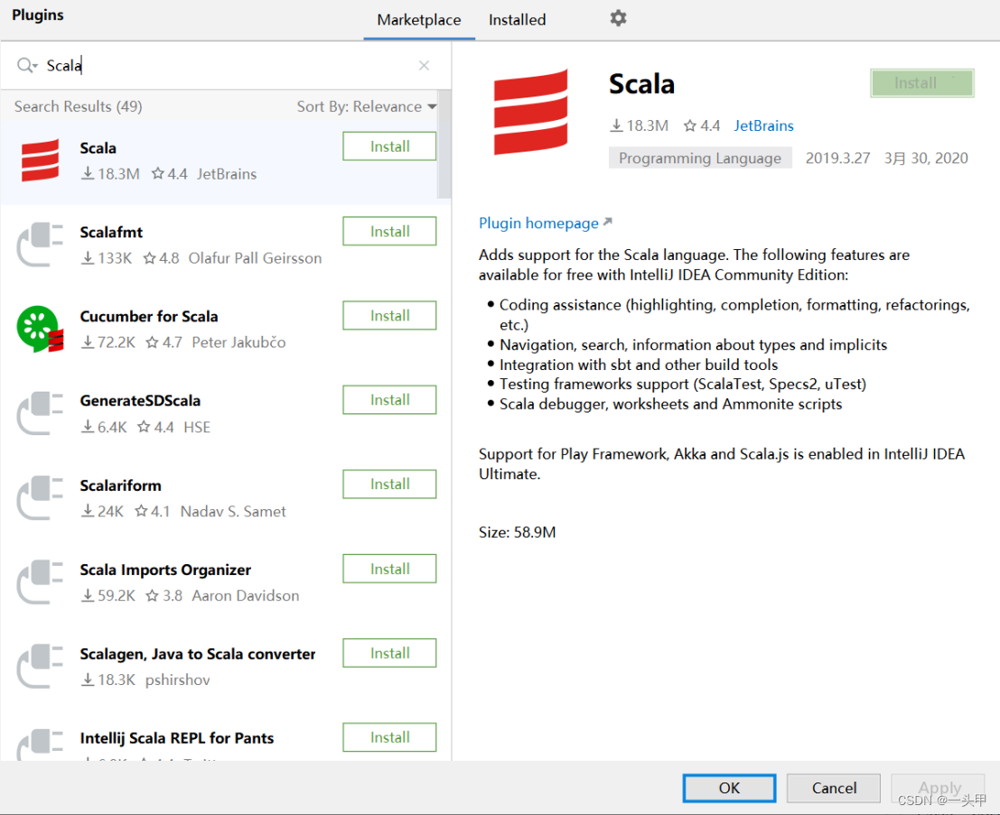

## 1.5 VMware, Ubuntu and Hadoop

This project also documents a virtualized Hadoop 2.10.2 environment. First install **VMware Workstation 17** and **Ubuntu 16**.


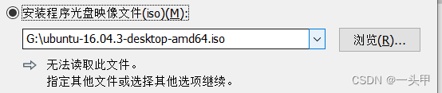

Log in to Ubuntu and create the `hadoop` user. The source used the following steps:

```bash
sudo passwd root
sudo useradd -m hadoop -s /bin/bash
sudo passwd hadoop
sudo adduser hadoop sudo
su hadoop
```

The original notes show root and user prompts; the commands above are formatted consistently for readability.

Install/configure the JDK and verify it:

```bash
java -version
```


Download Hadoop from the [Apache Hadoop website](https://hadoop.apache.org/) using Ubuntu's Firefox browser. The source uses **Hadoop 2.10.2**:

```bash
mv hadoop-2.10.2.tar.gz /home/hadoop
tar -xvf hadoop-2.10.2.tar.gz
```

The extracted directory is `/home/hadoop/hadoop-2.10.2/`.


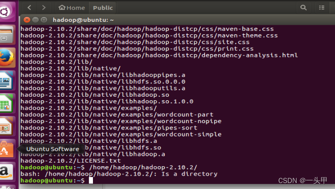

Configure the environment using `/etc/profile` and reload it:

```bash
sudo vim /etc/profile
source /etc/profile
hadoop version
```

The source supplies the detailed profile values in the screenshot rather than as copyable text.

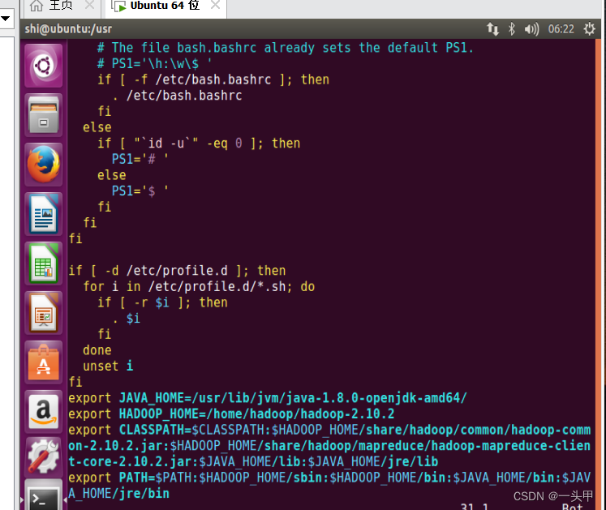


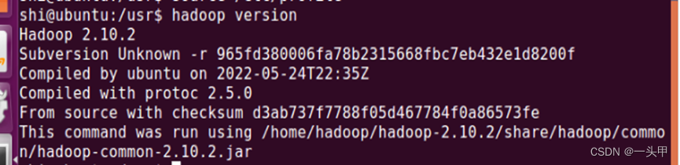

# 2. Project design

The original project covers four connected activities:

1. **Data collection:** scrape structured used-car listing information with Python.
2. **Data processing:** organize the collected data into usable tables or CSV/JSON formats.
3. **Data analysis:** calculate listing counts and relationships between vehicle age, mileage, price and city.
4. **Visualization:** display analytical results through HTML and chart components such as ECharts.

# 3. Implementation

## 3.1 Collecting vehicle listings with Python

The following is the **original illustrative script**, reformatted without replacing its placeholder domain, Cookie or User-Agent. Those placeholders mean it is **not immediately runnable**. For real collection, comply with website rules, robots policies and applicable privacy requirements.

```python
import csv

import requests
import parsel

f = open('datacar.csv', mode='a', encoding='utf-8', newline='')
csv_writer = csv.DictWriter(f, fieldnames=[
    '标题',
    '年份',
    '里程',
    '城市',
    '价格',
    '标签儿',
    '保修又没',
    '详情页',
])
csv_writer.writeheader()

for page in range(1, 51):
    print(f'=======ciajidi{page}yedeshujuneiron======')
    headers = {
        'Cookie': '......',
        'User-Agent': '......'
    }
    url = f'https://..........com/all/?page={page}&'
    response = requests.get(url=url, headers=headers)
    html_data = response.text
    print(response)
    selector = parsel.Selector(html_data)
    lis = selector.css('.Content_left .gongge_ul li')

    for li in lis:
        title = li.css('.title::attr(title)').get()
        car_info = li.css('.gongge_main p i::text').getall()
        year = car_info[0]
        mileage = car_info[1]
        city = car_info[2].strip()
        label = li.css('.car_tag em::text').get().strip()
        tag = li.css('.tc_label::text').get()
        price = li.css('.Total::text').get()
        href = li.css('.title::attr(href)').get()

        dit = {
            '标题': title,
            '年份': year,
            '里程': mileage,
            '城市': city,
            '价格': price,
            '标签儿': label,
            '保修又没': tag,
            '详情页': href,
        }
        csv_writer.writerow(dit)
        print(title, year, mileage, city, price, label, tag, href)
```

The collected fields are the vehicle title, year, mileage, city, price, listing tags, warranty label and detail-page URL. The original script writes these records to `datacar.csv`. It assumes a particular page structure and nonempty selector results, so an actual implementation would require appropriate error handling, selectors and credentials.

## 3.2 Functional design and visualization

### Analysis 1: Used-car listing trends by year

**Input:** `year`  
**Output:** `year`, `count`  
**Visualization:** bar chart

Count vehicles within the selected year range. The original implementation describes using SQL to aggregate data and converting the results to JSON for HTML/chart rendering.

**Data processing and analysis code screenshots:**

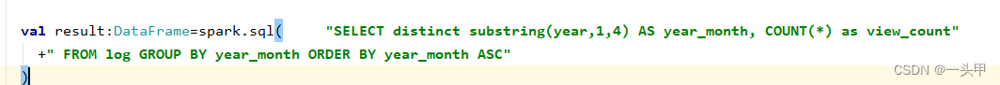

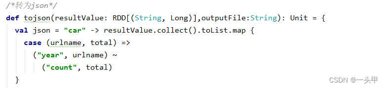

**HTML visualization code:**

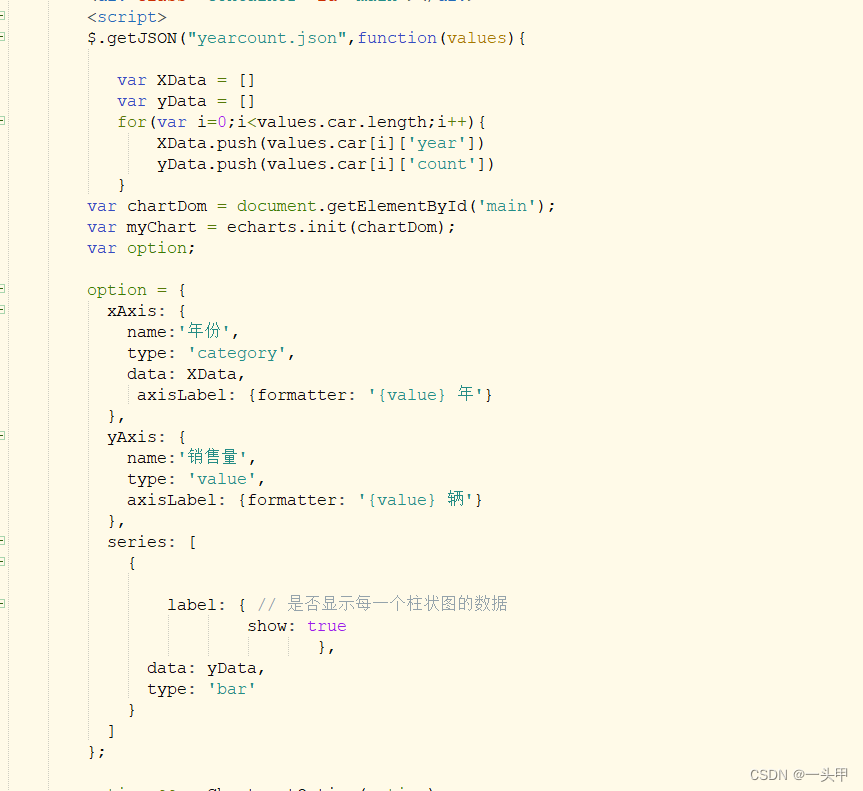

**Visualization result:**

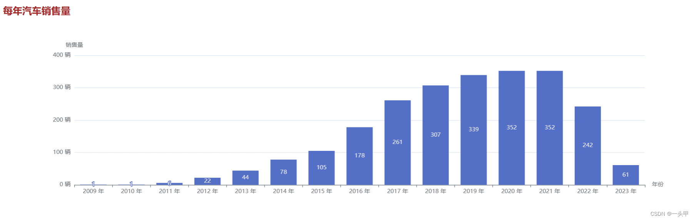

**Original interpretation:** The observed sample peaks around **2021**, followed by a decline. The original author speculated that pandemic-related circumstances could have affected this trend. This is a sample-level observation, not proof of a market-wide causal relationship; listing counts are also not necessarily completed vehicle sales.

### Analysis 2: Mileage and vehicle price

**Input:** `mileage`, `price`  
**Output:** `mileage`, `price`  
**Visualization:** line chart

Read the mileage and price fields, order or group records by mileage, and prepare the results using SQL/JSON for visualization.

**Data-processing code:**

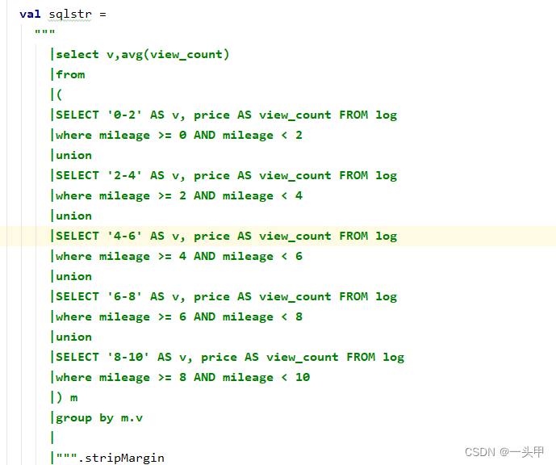

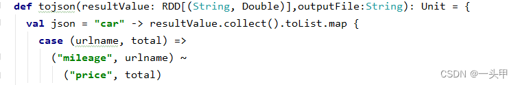

**HTML chart code:**


**Visualization result:**

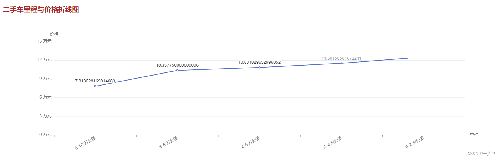

**Original interpretation:** The sample's lowest average listed price appeared in the **80,000–100,000 km** interval, while the highest appeared in **0–20,000 km**. Vehicle model, model year and brand may also influence prices, so this should not be interpreted as a controlled estimate of mileage's causal effect.

### Analysis 3: Preferred vehicle models by city

**Input:** `city`, `title`, `count`  
**Output:** `city`, `title`, `count`  
**Visualization:** 3D bar chart

Aggregate the number of vehicles for each city/model combination and transform SQL results into JSON for the chart.

**Data-processing code:**

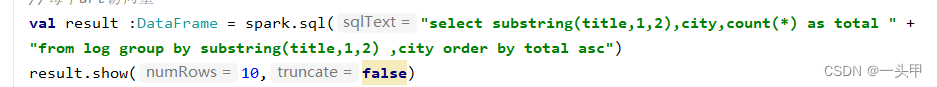

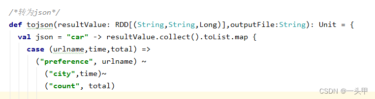

**HTML visualization code:**

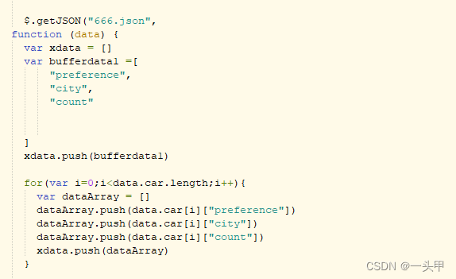


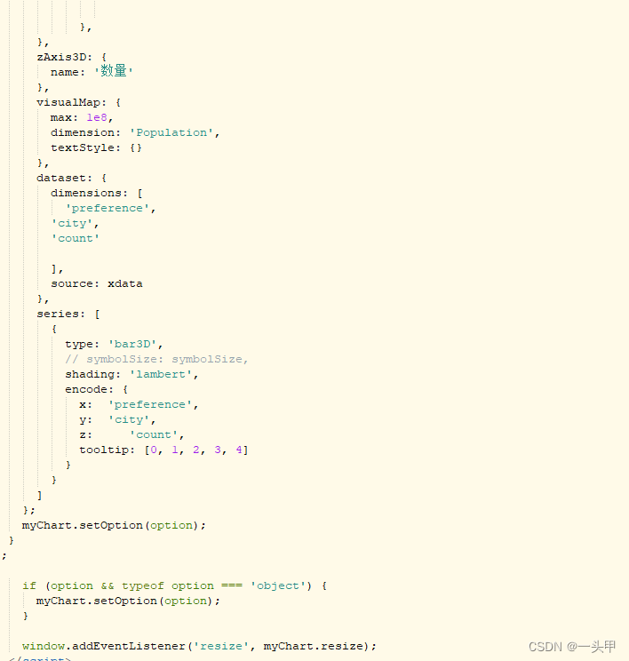

**Visualization result:**

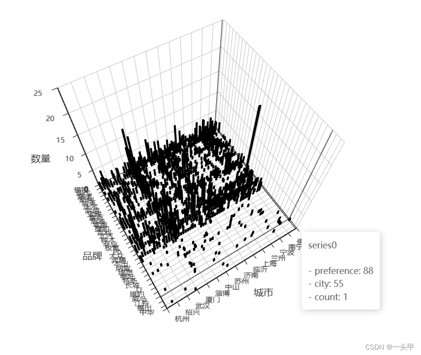

**Original interpretation:** Volkswagen appeared most frequently across the cities in the analyzed listings. Listing frequency does not establish completed sales volume or consumer preferences for the wider population.

### Analysis 4: Additional web data collection

The source also documents collecting listings from [Taoche's Zhengzhou site](https://zhengzhou.taoche.com/) using Python in PyCharm. The code and resulting console output are preserved in the screenshots.

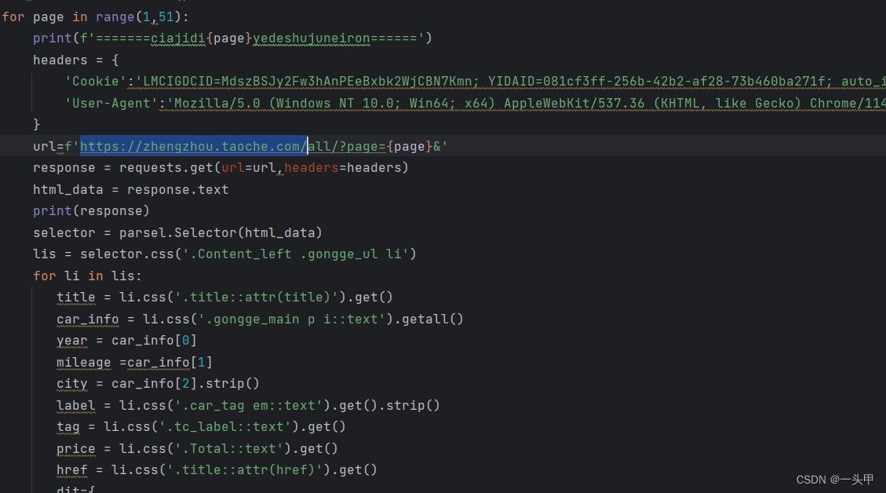

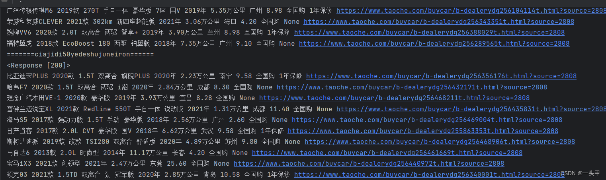

### Analysis 5: Local keyword search

Convert collected records to **JSON**, load them into an HTML page and search by keyword to retrieve matching car information.

**Implementation code:**

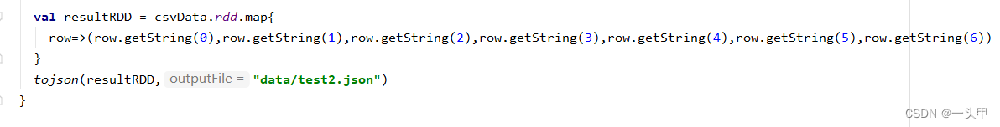

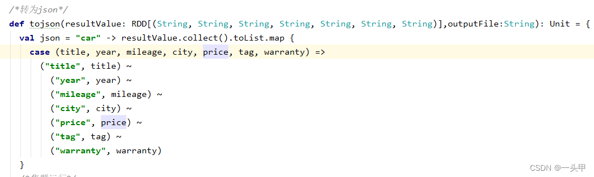

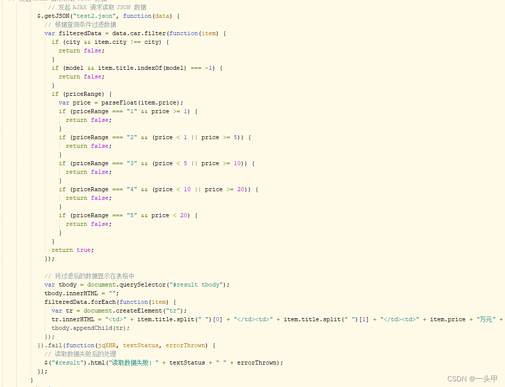

**HTML interface:**

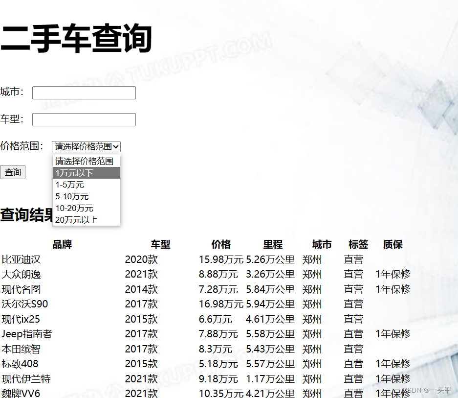

# 4. Conclusion

This project brought together **IntelliJ IDEA, HTML, Spark and ECharts** with Python data collection and analysis. It provided hands-on experience with environment configuration, web scraping, data processing, SQL-based aggregation, interactive charts and searching local JSON data. The interpretations above describe the project's historical listing sample, rather than the current used-car market.

---

*Original article: [Used-car data analysis on my CSDN blog](https://blog.csdn.net/weixin_75027717/article/details/137185817). The source's code, screenshots and historical software versions are retained where available; prose and commentary have been translated into English.*